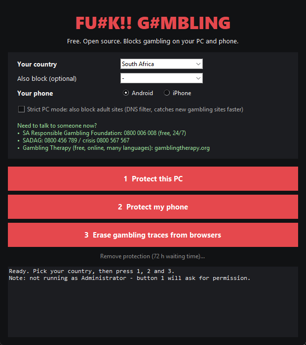
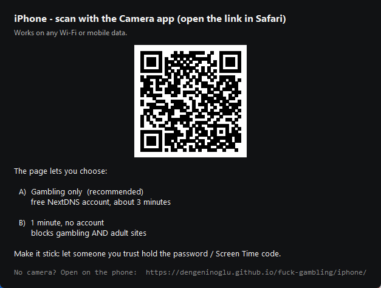
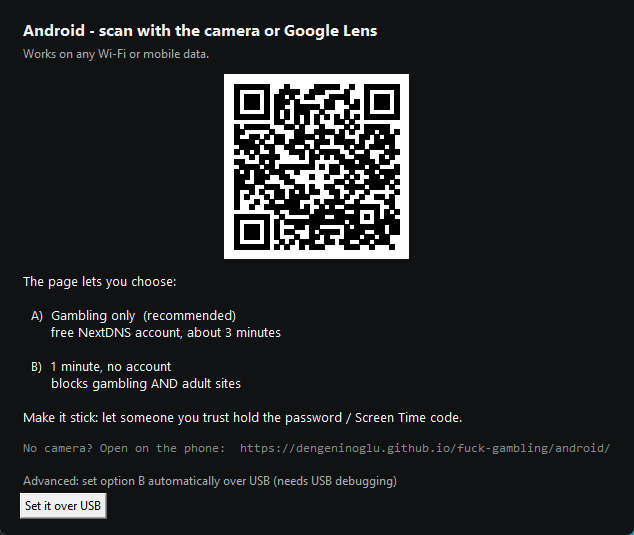

<h1 align="center">FU#K!! G#MBLING</h1>

<b>Block every betting and casino site on your computer and your phone. 
Free forever. Non-profit. No account. No ads. No data collected.</b>

  

<i>Made for everyone who wants out. · <a href="MANIFESTO.md">Manifesto</a> · <a href="MANIFESTO.tr.md">Manifesto (Türkçe)</a></i>

---

## 🤝 A non-profit project
FU#K!! G#MBLING is a **non-profit, volunteer project**. We don't sell anything, show ads or collect data, and we don't take a cut.
Gambling companies spend billions to keep people playing. This costs nothing and always will.

**Organisations** fighting gambling harm (helplines, clinics, charities, regulators): you may use, translate, rebrand and hand this out for free (MIT license). Open an issue and we'll help you set it up for your country.

---

## How to use it (3 minutes)

### Step 1 · Download and open
1. Click the red **DOWNLOAD** button above.
2. Open **FuckGambling.exe**. Windows asks *"Do you want to allow this app to make changes?"*, click **Yes**.
   > If a blue box says *"Windows protected your PC"*, click **More info → Run anyway**. Small free apps without a paid certificate always show this. The full source code is on this page.
3. Choose **your country** (this shows your local helpline) and **your phone** (Android or iPhone).

### Step 2 · Press the three buttons

| Button | What happens |
|---|---|
| **1 Protect this PC** | Blocks ~45,000 betting/casino sites in **every browser**, and **nothing else**. Repairs itself every 30 minutes. Optional *strict mode* adds a DNS filter that catches brand-new gambling sites too (it also blocks adult sites). |
| **2 Protect my phone** | Scan the QR code, and a page opens with two choices: **A) gambling only** (free NextDNS account, ~3 min) or **B) 1 minute, no account** (also blocks adult sites). iPhone and Android, no cable. |
| **3 Erase gambling traces** | Deletes gambling history, searches, cookies, saved logins and suggestions from Chrome, Edge, Brave and Opera. Everything else stays. You see a list first. |

&nbsp;&nbsp;

> 📱 **No computer?** Open the setup page on your phone: **[iPhone](https://dengeninoglu.github.io/fuck-gambling/iphone/)** · **[Android](https://dengeninoglu.github.io/fuck-gambling/android/)**

### Step 3 · Make it stick (most important)
A blocker buys you time. These steps make sure an urge can't undo it in a weak moment:
- 🔑 **Give a code to someone you trust.** iPhone: let them set the *Screen Time* passcode. Android: *Google Family Link*. They keep it, not you.
- 🏦 **Ask your bank to block gambling payments** on your cards (most banking apps have this).
- 🚫 **Self-exclude** from betting companies if your country has a scheme (GAMSTOP UK, BetStop Australia, …).
- 📞 **Talk to someone.** The app shows free helplines for your country.

---

## ✅ What keeps working
Banking apps, crypto exchanges, work, school, YouTube, social media and **help & recovery sites**. Only gambling is blocked.

## ❓ FAQ
**Can I turn it off?** Yes, on purpose slowly: *Remove protection* starts a **72-hour waiting time**. The urge passes long before that. You can cancel the request any time.
**Does it break my phone?** No. It only changes the phone's standard *Private DNS* / DNS profile setting, and you can switch it back in Settings.
**Does it track me?** No. There is no server, no account and no analytics. It runs on your device only.
**Does it block porn or anything else?** No. By default only gambling is blocked. Only the *no-account* phone option and the optional *strict PC mode* use a public filter that also blocks adult sites. There is no free gambling-only filter that works without an account, so we tell you clearly before you choose.
**Mac / TV / tablet / the whole house?** Gambling only: a free NextDNS account with the *Gambling* category, set on your router. No account: router DNS `86.54.11.12` / `86.54.11.212` (also blocks adult sites).
**I already use Gamban / BetBlocker.** Fine. The app detects them and adds its block list on top without fighting them.

## Need help right now?
| Country | Free helpline |
|---|---|
| 🇿🇦 South Africa | **0800 006 008** (SA Responsible Gambling Foundation, 24/7) |
| 🇬🇧 United Kingdom | **0808 8020 133** (National Gambling Helpline, 24/7) |
| 🇺🇸 United States | **1-800-GAMBLER** |
| 🇦🇺 Australia | **1800 858 858** (Gambling Help, 24/7) |
| 🇹🇷 Türkiye | **115** (YEDAM, 7/24) |
| 🌍 Anywhere | [gamblingtherapy.org](https://www.gamblingtherapy.org) (free, online, many languages) · [Gamblers Anonymous](https://www.gamblersanonymous.org) |

---

<b>For techies: how it works, building, contributing</b>

- **PC (Windows 10/11):** `windows/engine.ps1` runs as a SYSTEM scheduled task (startup, logon, every 30 min). It writes [StevenBlack gambling-only](https://github.com/StevenBlack/hosts) hosts + country lists + numbered-mirror patterns into the hosts file, pins help sites to real IPs, in *strict mode* sets adapter DNS to [DNS4EU](https://www.joindns4.eu/) *Protective + Child Protection* (with DoH; also blocks adult content), and locks Chrome/Edge/Brave/Firefox DoH via policy. Uninstall uses a 72 h cooldown file. Emergency removal: [docs/UNINSTALL.md](docs/UNINSTALL.md).
- **Android:** Private DNS: the user's own NextDNS endpoint (gambling only) or `child.joindns4.eu` (DoT, gambling + adult). Optional USB/adb automation for the latter.
- **iPhone:** NextDNS profile (apple.nextdns.io) or our `com.apple.dnsSettings.managed` DNS4EU profile on GitHub Pages, opened via QR. Guide: [docs/IPHONE.md](docs/IPHONE.md).
- **Run from source:** Python 3.10+, `pip install qrcode`, then `START.bat` (or `python -m fg`).
- **Build exe:** `pip install pyinstaller qrcode` then PyInstaller `--onefile --windowed --uac-admin` with `lists` and `windows` as data (see release notes).
- **Add your country:** edit `lists/countries.json` (name + free helplines) and add `lists/<code>.txt` (gambling sites), `lists/allow-<code>.txt` (banks), `lists/mirrors-<code>.txt`. PRs welcome!

**Known limits:** VPNs/Tor bypass DNS blocking. NextDNS free = 300k lookups/month (after that it stops filtering until next month). The DNS4EU filter also hides some recovery websites (phone helplines always work). A determined admin can remove anything on their own PC. That is why Step 3 matters.

MIT License · Block lists: StevenBlack/hosts · DNS: DNS4EU · Made with anger and hope.

