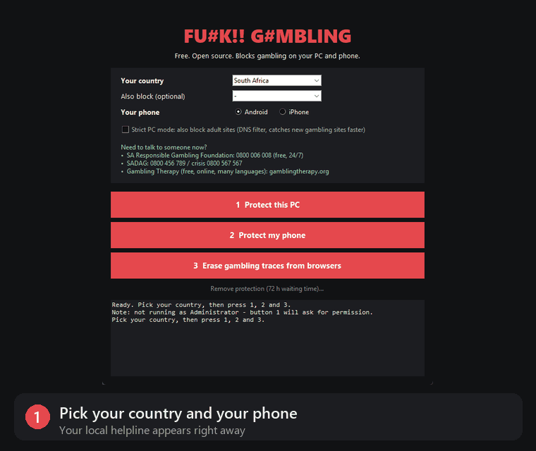
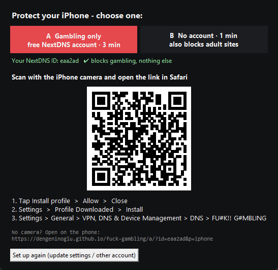
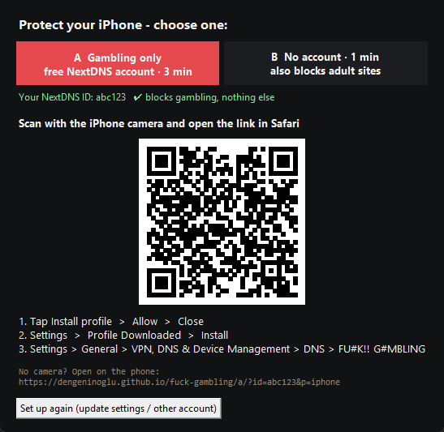
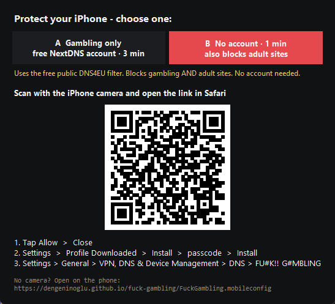

  
  
  
  
  

  
  &nbsp;
  

<a href="https://dengeninoglu.github.io/fuck-gambling/"><b>🌐 Website</b></a> · <a href="MANIFESTO.md">Manifesto</a> · <a href="MANIFESTO.tr.md">Manifesto (Türkçe)</a> · <a href="#-need-help-right-now">Helplines</a>

---

## ❤️ Why we built this

**This app was built within a few hours of realising how much money I had spent on gambling.**

Betting companies have teams of engineers and psychologists whose only job is to keep you playing: bonuses, "free bets", notifications at 2 a.m., a new mirror site the day the old one gets blocked. The blockers that exist are either paid or so strict that they also block your bank, your crypto or half the internet, so people switch them off.

We wanted something different:
- **Free, forever.** The people who need a blocker most are often the ones who just lost their money.
- **Only gambling.** Your bank, payments, work, social media and adult life are none of our business.
- **Hard to undo in a weak moment, easy to set up on a good one.** If setup is hard, nobody does it. If removal is easy, an urge undoes it.
- **Open and honest.** Every line of code is public. We tell you exactly what each option blocks.

FU#K!! G#MBLING is a **non-profit, volunteer project**. We don't sell anything, show ads or collect data, and we don't take a cut. **Organisations** fighting gambling harm may use, translate, rebrand and hand it out for free (MIT license). [Open an issue](https://github.com/Dengeninoglu/fuck-gambling/issues) and we'll help.

Found a bug? Please tell us: [open an issue](https://github.com/Dengeninoglu/fuck-gambling/issues).

---

## 🚀 How to use it (about 5 minutes)

### 1 · Download and open
Click the red **DOWNLOAD** button. Open **FuckGambling.exe**, and when Windows asks *"Allow this app to make changes?"* click **Yes**.
> A blue *"Windows protected your PC"* box? Click **More info → Run anyway**. Free apps without a paid certificate always get this. The full source code is on this page.

Pick **your country** (it shows your local helpline) and **your phone** (Android or iPhone).

### 2 · Press the three buttons

| | |
|---|---|
| **1 Protect this PC** | Blocks ~45,000 betting & casino sites in **every browser**, and nothing else. Repairs itself every 30 minutes. Removal takes 72 hours. |
| **2 Protect my phone** | Choose **A** or **B** (below). The app shows a QR code: scan it, then tap *Install* (iPhone) or *Copy → Paste* (Android). No cable. Tested on real iPhones and Android phones. |
| **3 Erase gambling traces** | Deletes betting history, searches, cookies and saved logins from Chrome, Edge, Brave and Opera, and leaves the rest alone. You see the list first. |

### Phone: A or B?

| | **A · Gambling only** ✅ recommended | **B · One minute, no account** |
|---|---|---|
| Blocks | Betting & casino sites **only** | Betting & casino **and adult sites** |
| Needs | Free [NextDNS](https://nextdns.io) account. **The app sets it up for you**: sign up, copy your API key, paste it. Done. | Nothing |
| Stops VPN tricks | Yes, turned on automatically (*Block Bypass Methods*) | No |
| Checked before you start | Yes. The app tests that betting sites are really blocked before it shows your QR code | Yes |
| Limit | 300,000 lookups/month free (enough for most phones) | None |

&nbsp;
&nbsp;

> 📱 **No computer?** On your phone open **[A: gambling only](https://dengeninoglu.github.io/fuck-gambling/a/)**, or B (no account, also blocks adult sites) for **[iPhone](https://dengeninoglu.github.io/fuck-gambling/FuckGambling.mobileconfig)** / **[Android](https://dengeninoglu.github.io/fuck-gambling/android/#b)**.

### 3 · Make it stick (the most important step)
A blocker buys you time. These steps make sure a bad night can't undo it:
- 🔑 **Give the keys to someone you trust:** your NextDNS password, the iPhone *Screen Time* passcode, Android *Family Link*. They keep them, not you.
- 🚫 **Block VPNs:** option A turns on NextDNS *Block Bypass Methods* for you. On iPhone also set Screen Time → *VPN & DNS: Don't Allow*.
- 🏦 **Ask your bank to block gambling payments** (most banking apps have a switch).
- 📝 **Self-exclude** where your country has a scheme (GAMSTOP UK, BetStop Australia, …).
- 📞 **Talk to someone.** The app shows free helplines for your country.

---

## ❓ FAQ

**Does it block porn or anything else?**
No. By default **only gambling** is blocked. Only option **B** on phones and the optional *strict mode* on the PC use a free public filter that also blocks adult sites, and we tell you before you choose. There is no free gambling-only filter that works without an account, which is why option A uses a free NextDNS account.

**Can someone get around it with a VPN?**
Partly, and we'd rather be honest about it.
- **PC:** the hosts list keeps working even with a VPN on, because it's checked on your computer before any DNS. A brand-new mirror site that isn't on the list yet could still get through.
- **Phone:** a VPN can skip DNS filtering. Option A turns on NextDNS **Block Bypass Methods**, which blocks most VPN, proxy and Tor services. On iPhone also set *Screen Time → VPN & DNS → Don't Allow*, and on Android use *Family Link* to stop new VPN apps being installed.
- **Everywhere:** iCloud Private Relay and Opera's built-in VPN also skip filters. Turn them off.

No blocker can stop someone who is determined to get around it. What it can do is put enough steps in the way that the urge passes first. That's why the "make it stick" steps matter more than any list.

**Can I turn it off?** Yes, on purpose slowly. On the PC, *Remove protection* starts a **72-hour waiting time** that you can cancel at any time. On phones, whoever holds the password decides.

**Will it break my phone?** No. It only changes the phone's standard DNS setting, which you can switch back in Settings.

**Does it track me?** No. There's no server of ours, no account with us and no analytics. NextDNS (option A) is your own account with them. Your NextDNS API key is used once to switch on the right settings and is **never saved**.

**I already use Gamban / BetBlocker.** Fine. The app detects them and adds its block list without fighting them.

**Mac / TV / the whole house?** Put your NextDNS (gambling category) on your router, or for B the router DNS `86.54.11.12` / `86.54.11.212`.

---

## 📞 Need help right now?
| Country | Free helpline |
|---|---|
| 🇿🇦 South Africa | **0800 006 008** (SA Responsible Gambling Foundation, 24/7) |
| 🇬🇧 United Kingdom | **0808 8020 133** (National Gambling Helpline, 24/7) |
| 🇺🇸 United States | **1-800-GAMBLER** |
| 🇦🇺 Australia | **1800 858 858** (Gambling Help, 24/7) |
| 🇹🇷 Türkiye | **115** (YEDAM, 7/24) |
| 🌍 Anywhere | [gamblingtherapy.org](https://www.gamblingtherapy.org) (free, online, many languages) · [Gamblers Anonymous](https://www.gamblersanonymous.org) |

---

<b>For techies: how it works, building, contributing</b>

- **PC (Windows 10/11):** `windows/engine.ps1` runs as a SYSTEM scheduled task (startup, logon, every 30 min). It writes [StevenBlack gambling-only](https://github.com/StevenBlack/hosts) hosts + country lists + numbered-mirror patterns (`brand1.com … brand1000.com`) into the hosts file, pins help sites to their real IPs, and locks Chrome/Edge/Brave/Firefox Secure DNS via policy so browsers can't skip the hosts file. *Strict mode* additionally sets adapter DNS to [DNS4EU](https://www.joindns4.eu/) *Child Protection* (with DoH). Removal uses a 72 h cooldown file. Emergency removal: [docs/UNINSTALL.md](docs/UNINSTALL.md).
- **Phones, option A:** with the user's NextDNS API key (used once, never stored) the app picks/creates a profile via `api.nextdns.io`, turns on the `gambling` category and `blockBypass`, allowlists help & recovery sites, then verifies over DoH that betting domains resolve to `0.0.0.0` before showing a QR code. `docs/a/` builds an iPhone `com.apple.dnsSettings.managed` profile in the browser from the profile ID, or shows `<id>.dns.nextdns.io` for Android Private DNS.
- **Phones, option B:** DNS4EU Child Protection: a static iPhone profile on GitHub Pages, and `child.joindns4.eu` for Android Private DNS (optional adb automation).
- **Browser cleaner:** reads Chromium SQLite DBs (History, Cookies, Login Data, Favicons, Shortcuts, Top Sites…), does a dry-run on copies, then deletes only matching rows.
- **Run from source:** Python 3.10+, `pip install qrcode`, then `START.bat` (or `python -m fg`).
- **Build:** `pip install pyinstaller qrcode`, then PyInstaller `--onefile --windowed --uac-admin` with `lists` and `windows` as data, excluding PIL/numpy (~12 MB).
- **Add your country:** edit `lists/countries.json` (name + free helplines) and add `lists/<code>.txt` (gambling sites), `lists/allow-<code>.txt` (banks), `lists/mirrors-<code>.txt`. PRs welcome!

MIT License · Block lists: StevenBlack/hosts + community country lists · DNS: NextDNS (A) / DNS4EU (B) · Made with anger and hope.

